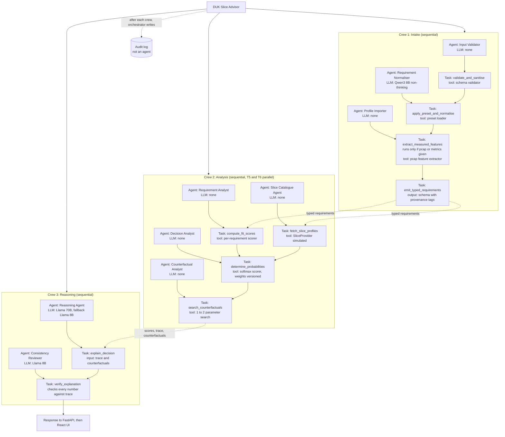

Only two agents call an LLM for their main work: the Requirement Normaliser (Qwen3 8B) and the Reasoning Agent (Llama 70B). The Consistency Reviewer uses Llama 8B because it only compares text against numbers. Everything else is deterministic, which keeps the probabilities reproducible.
